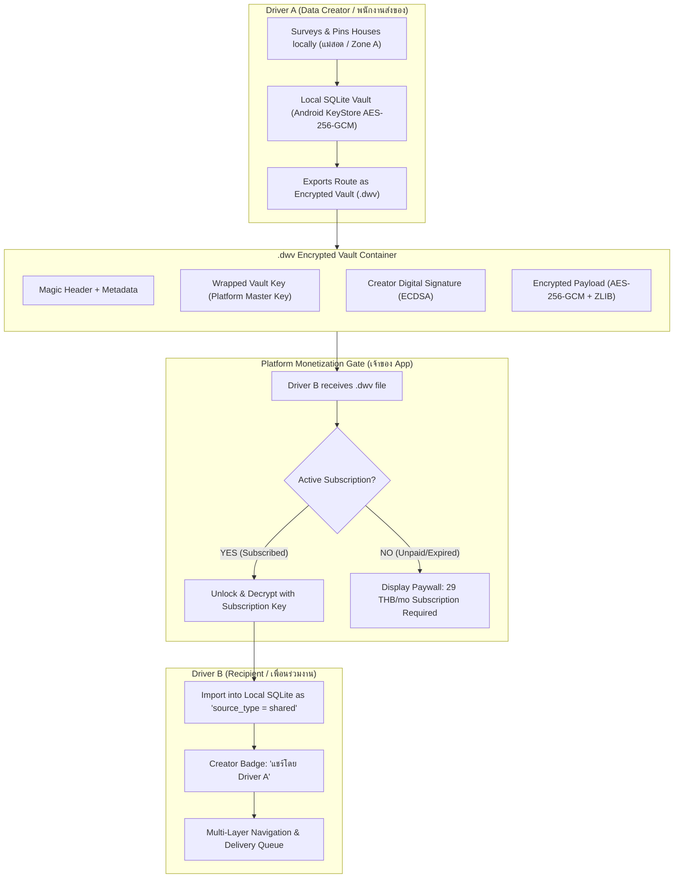

# DROPWAY MOBILE 2.0 — OFFLINE-FIRST SECURE VAULT & MONETIZATION ARCHITECTURE

This document outlines the complete architectural overhaul of **Dropway Mobile**: transitioning from Neon PostgreSQL to a **100% Offline-First Secure Vault**, implementing **Anti-Extraction Security**, a **Proprietary Encrypted Sharing System (`.dwv`)**, a **Creator-Attributed Subscription Monetization Model**, and a **16-Provider Multi-Layer Map Engine**.

---

## 1. System Overview & Architecture Flow



---

## 2. Phase 1: Complete Elimination of Neon Database (100% Offline-First)

### 2.1 Why Eliminate Neon
- **Zero Server Dependency:** Delivery drivers operate in rural areas, underground parkings, border regions (e.g. Mae Sot border valleys) where 4G/5G connections drop frequently.
- **Zero Maintenance Cost:** No recurring database server bills or connection pool limits for the app owner.
- **Instant Response Times:** Local SQLite read/write operations execute in sub-millisecond speeds (< 2ms) compared to network latencies (150–500ms).

### 2.2 Local SQLite Schema Consolidation
All features (Navigation, Parcel Scanning, House Vault, User Preferences) are consolidated into the local database engine `LocalHouseDatabase` (to be evolved into `DropwayDatabase`):

```sql
-- 1. House Vault Table (Pre-seeded with 4,530 Mae Sot records + Driver additions)
CREATE TABLE houses (
    id TEXT PRIMARY KEY,
    full_name TEXT,
    phone TEXT,
    address TEXT,
    lat REAL,
    lng REAL,
    note TEXT,
    quantity INTEGER NOT NULL DEFAULT 1,
    creator_id TEXT,
    creator_name TEXT,
    source_type TEXT NOT NULL DEFAULT 'personal', -- 'personal' | 'shared' | 'system'
    is_shared INTEGER NOT NULL DEFAULT 0,
    share_token TEXT,
    shared_by_user_id TEXT,
    expires_at TEXT,
    record_version INTEGER NOT NULL DEFAULT 1,
    created_at TEXT NOT NULL,
    updated_at TEXT NOT NULL
);

-- 2. Navigation Stops Table (Replaces Neon navigation_stops)
CREATE TABLE navigation_stops (
    nav_id TEXT PRIMARY KEY,
    user_id TEXT NOT NULL DEFAULT 'local-driver',
    house_id TEXT,
    nav_note TEXT,
    nav_priority INTEGER NOT NULL DEFAULT 0,
    delivery_status TEXT NOT NULL DEFAULT 'pending', -- 'pending' | 'delivered' | 'reported'
    delivery_note TEXT,
    delivered_at TEXT,
    report_reason TEXT,
    reported_at TEXT,
    driver_note TEXT,
    tracking_number TEXT,
    parcel_count INTEGER NOT NULL DEFAULT 1,
    full_name TEXT,
    phone TEXT,
    address TEXT,
    lat REAL,
    lng REAL,
    note TEXT,
    created_at TEXT NOT NULL,
    FOREIGN KEY(house_id) REFERENCES houses(id) ON DELETE SET NULL
);

-- 3. Scanned Parcels Table (Replaces Neon parcels for duplicate tracking checks)
CREATE TABLE scanned_parcels (
    tracking_number TEXT PRIMARY KEY,
    scanned_at TEXT NOT NULL,
    associated_house_id TEXT,
    status TEXT NOT NULL DEFAULT 'active'
);

-- 4. Subscription License Table (Local Cryptographic License)
CREATE TABLE subscription_licenses (
    license_id TEXT PRIMARY KEY,
    plan_name TEXT NOT NULL,
    subscriber_id TEXT NOT NULL,
    valid_from TEXT NOT NULL,
    expires_at TEXT NOT NULL,
    signature TEXT NOT NULL,
    is_active INTEGER NOT NULL DEFAULT 1
);
```

---

## 3. Phase 2: Database Security & Anti-Extraction Protection

The user requested that the database file cannot be easily extracted, searched, or ripped from the phone.

### 3.1 Attack Vectors & Defense Strategy

| Attack Vector | Risk | Defense Implementation |
| :--- | :--- | :--- |
| **ADB Backup Extraction** | Attacker runs `adb backup` to dump SQLite `.db` file | Set `android:allowBackup="false"` in `AndroidManifest.xml` |
| **Standard File Explorers** | Non-root users browse SD/External storage | Keep database exclusively inside private internal directory `context.getDatabasePath()` or `context.noBackupFilesDir` |
| **Rooted Device / Forensic Inspection** | Root user inspects raw SQLite tables and reads coordinates/phones | **Column-Level Hardware AES-256-GCM Encryption** via `AndroidKeyStore`. Sensitive columns (`lat`, `lng`, `phone`, `note`) are stored as encrypted ciphertexts. |
| **Database File Tampering** | Attacker edits rows or injects fake records | **HMAC-SHA256 File Signature**: Verified on app startup. If file has been modified externally, the app rejects loading until verified. |

### 3.2 Hardware-Backed Android KeyStore
- The master AES-256 key is generated inside the Android **Hardware Security Module (HSM) / Trusted Execution Environment (TEE)** (`AndroidKeyStore`).
- The private cryptographic key **never leaves the chip hardware**. Even with root access, dumping memory cannot extract the master key from the TEE.

---

## 4. Phase 3: Proprietary Encrypted Sharing (`.dwv` - Dropway Vault)

> [!CAUTION]
> **No Plain JSON or CSV Sharing:**
> If data is shared as JSON or CSV, any user can open it in a text editor, copy coordinates, or distribute it freely without paying for the app subscription. Therefore, plain text export is strictly eliminated.

### 4.1 `.dwv` Binary Container Specification
The Dropway Vault file format (`.dwv`) is a sealed binary envelope:

```
+-----------------------------------------------------------------------+
| 1. MAGIC BYTES (7 bytes): 'DWVAULT'                                   |
| 2. FORMAT VERSION (1 byte): 0x02                                      |
+-----------------------------------------------------------------------+
| 3. PUBLIC HEADER (Cleartext Metadata for UI Preview):                 |
|    - Vault Title: "แม่สอด โซน A - ตลาดพาเจริญ"                         |
|    - Creator ID: "drv_th_8849"                                        |
|    - Creator Name: "สมชาย พนักงานสายส่ง 3"                             |
|    - Record Count: 240 houses                                         |
|    - Created Date: "2026-11-22T04:00:00Z"                             |
|    - Checksum: SHA-256 (32 bytes)                                     |
+-----------------------------------------------------------------------+
| 4. ENCRYPTED KEY ENVELOPE (Wrapped with Platform Owner Key):          |
|    - Ephemeral IV / Nonce (12 bytes)                                  |
|    - Encrypted Session Data Key (AES-256-GCM)                         |
|    - Licensing Salt (16 bytes)                                        |
|    - Creator Signature (ECDSA / SHA-256)                              |
+-----------------------------------------------------------------------+
| 5. ENCRYPTED DATA PAYLOAD:                                            |
|    - Ciphertext (AES-256-GCM) of ZLIB-compressed House Records        |
|    - Contains: Names, Addresses, Phones, Latitude, Longitude, Notes   |
+-----------------------------------------------------------------------+
| 6. GCM AUTHENTICATION TAG (16 bytes)                                  |
+-----------------------------------------------------------------------+
```

### 4.2 Security Guarantee
- If someone opens a `.dwv` file on a PC or phone without Dropway, it appears as gibberish binary data.
- The Session Data Key can **only** be unwrapped by the Dropway Mobile App when a **valid active subscription** is present.

---

## 5. Phase 4: Creator Ownership & Subscription Monetization

### 5.1 The Business Model
- **App Owner (You):** Provides the platform, OCR scanning engine, secure offline vault, multi-layer map rendering, and routing optimization. Monetizes via subscription (29–99 THB/month).
- **Delivery Drivers (Creators):** Drive thousands of kilometers, discover exact house alleys, and pin accurate roof coordinates. They own their house records.
- **Peer Sharing Workflow:**
  - Driver A creates a route and exports a `.dwv` file.
  - Driver A gives the `.dwv` file to Colleague Driver B (via LINE, Bluetooth, or AirDrop equivalent).
  - When Driver B opens the `.dwv` file in Dropway:
    - **Active Subscriber:** The vault unlocks, records are imported into Driver B's local database marked as `source_type = 'shared'`, with Driver A's name proudly badged.
    - **Non-Subscriber / Expired:** The app presents the **Dropway Subscription Paywall**:
      *"คลังนี้แชร์โดย [สมชาย]. สมัครแพ็กเกจ Dropway รายเดือน (29 บาท) เพื่อปลดล็อกพิกัดนำทางและรายละเอียด"*
    - **Expired Subscription Policy:** If Driver B's subscription expires later, Driver B's own personal houses remain 100% accessible, but the shared routes are locked/blurred until subscription renewal.

### 5.2 Offline Cryptographic Licensing Ticket
To support 100% offline verification, subscriptions are represented by a **Cryptographically Signed License Ticket**:
- Platform Owner signs the license with an **Asymmetric Private Key (Ed25519 / RSA-2048)**.
- The Dropway App contains the **Public Key** embedded in the binary.
- Verification is performed 100% locally on-device without needing to connect to any server!
- The license contains: `subscriber_id`, `plan_id`, `valid_from`, `expires_at`, `device_fingerprint`.

---

## 6. Phase 5: Multi-Provider Map Architecture (16 Tile Layer Providers)

The user requested the ability to choose from a comprehensive list of map providers. Here is the feasibility analysis and configuration table:

### 6.1 Map Providers Comparison Table

| # | Provider Name | Category | Free to Use? | URL / Integration Method | Status / Note |
| :- | :--- | :--- | :-: | :--- | :--- |
| 1 | **Google Maps (Road / แผนที่)** | Street | Available | `https://mt{s}.google.com/vt/lyrs=m&x={x}&y={y}&z={z}` | Standard road map, Thai street names |
| 2 | **Google Maps (Hybrid / แผนที่+ดาวเทียม)** | Satellite | Available | `https://mt{s}.google.com/vt/lyrs=y&x={x}&y={y}&z={z}` | Satellite photo with road and place labels |
| 3 | **Google Maps (Satellite / ดาวเทียมเพียว)** | Satellite | Available | `https://mt{s}.google.com/vt/lyrs=s&x={x}&y={y}&z={z}` | High-res satellite imagery without overlays |
| 4 | **Google Maps (Terrain / ภูมิประเทศ)** | Topo | Available | `https://mt{s}.google.com/vt/lyrs=p&x={x}&y={y}&z={z}` | Elevation contours and natural terrain |
| 5 | **Google Maps (Traffic / สภาพจราจร)** | Traffic | Available | `https://mt{s}.google.com/vt/lyrs=m,traffic&x={x}&y={y}&z={z}` | Road map with live traffic congestion lines |
| 6 | **OpenStreetMap (OSM Standard)** | Open | 100% Free | `https://{s}.tile.openstreetmap.org/{z}/{x}/{y}.png` | Global open-source map, lightweight |
| 7 | **ESRI World Imagery (Satellite)** | Satellite | 100% Free | `https://server.arcgisonline.com/ArcGIS/rest/services/World_Imagery/MapServer/tile/{z}/{y}/{x}` | High-resolution satellite tiles worldwide |
| 8 | **ESRI World Terrain** | Topo | 100% Free | `https://server.arcgisonline.com/ArcGIS/rest/services/World_Terrain_Base/MapServer/tile/{z}/{y}/{x}` | Detailed land elevation and terrain base |
| 9 | **ESRI World Topo Map** | Topo | 100% Free | `https://server.arcgisonline.com/ArcGIS/rest/services/World_Topo_Map/MapServer/tile/{z}/{y}/{x}` | Topographic map with hillshading and contours |
| 10 | **ESRI World Street Map** | Street | 100% Free | `https://server.arcgisonline.com/ArcGIS/rest/services/World_Street_Map/MapServer/tile/{z}/{y}/{x}` | High-contrast clean street network |
| 11 | **ESRI World Shaded Relief** | Topo | 100% Free | `https://server.arcgisonline.com/ArcGIS/rest/services/World_Shaded_Relief/MapServer/tile/{z}/{y}/{x}` | Realistic 3D terrain mountain shading |
| 12 | **ESRI World Physical Map** | Nature | 100% Free | `https://server.arcgisonline.com/ArcGIS/rest/services/World_Physical_Map/MapServer/tile/{z}/{y}/{x}` | Forests, water bodies, and physical features |
| 13 | **ESRI NatGeo World Map** | Cartography | 100% Free | `https://server.arcgisonline.com/ArcGIS/rest/services/NatGeo_World_Map/MapServer/tile/{z}/{y}/{x}` | Classic National Geographic styling |
| 14 | **OpenTopoMap** | Topo | 100% Free | `https://{s}.tile.opentopomap.org/{z}/{x}/{y}.png` | European-style topographic contour map |
| 15 | **Wikimedia / CartoDB Voyager** | Clean Vector | 100% Free | `https://{s}.basemaps.cartocdn.com/rastertiles/voyager/{z}/{x}/{y}.png` | Fast, clean, high-contrast city map |
| 16 | **IGN Plan (France)** | National | Free (Fr) | `https://data.geopf.fr/wmts?...` | Specialized French national portal tiles |

### 6.2 Implementation in Compose & Leaflet
We organize the map layers into 4 selectable categories in the UI:
1. **ดาวเทียม (Satellite Imagery):** Google Hybrid, Google Satellite, ESRI Satellite
2. **ถนนและการนำทาง (Street Navigation):** Google Roads, Google Traffic, OSM Standard, ESRI Street, CartoDB Voyager
3. **ภูมิประเทศและความสูง (Terrain & Topo):** ESRI Topo, Google Terrain, ESRI Relief, OpenTopoMap, ESRI NatGeo
4. **แผนที่เฉพาะพื้นที่ (Specialized):** IGN Plan (France), ESRI Physical

---

## 7. Migration & Execution Plan

### Step-by-Step Implementation Roadmap:
1. **Step 1: Database Migration to 100% Local SQLite (`DropwayDatabase`)**
   - Add `navigation_stops`, `scanned_parcels`, and `subscription_licenses` tables to `LocalHouseDatabase`.
   - Implement local navigation stop queries (reorder, update status, clear delivered, driver notes).
2. **Step 2: Clean Removal of Neon Database References**
   - Delete `NeonClient.kt`.
   - Update `MainActivity.kt`, `ScanScreen.kt`, `NavigationScreen.kt`, and `HousesScreen.kt` to call `LocalHouseRepository` / `LocalDatabase` directly.
   - Refactor `SettingsScreen.kt` to replace Neon connection cards with Vault Management and Map Preferences.
3. **Step 3: Encrypted Vault Engine (`VaultCryptoManager`)**
   - Build hardware-backed AES-256-GCM encryption for sensitive local columns.
   - Build `.dwv` binary packager and unpacker with subscription verification gating.
4. **Step 4: 16-Provider Multi-Layer Map Engine**
   - Implement map provider selector sheet in `MapPickerDialog.kt`.
   - Save the driver's preferred default map style in `PreferencesManager`.
5. **Step 5: Subscription Management & Paywall UI**
   - Add Subscription Management screen in Settings.
   - Add Paywall dialog when attempting to import a `.dwv` file without an active subscription.
6. **Step 6: Unit Testing, APK Build & Git Push**
   - Add unit tests for VaultCryptoManager, DWV packaging, and offline navigation stops.
   - Build debug APK (`assembleDebug`) and commit & push to remote repository per `AGENT.md`.
