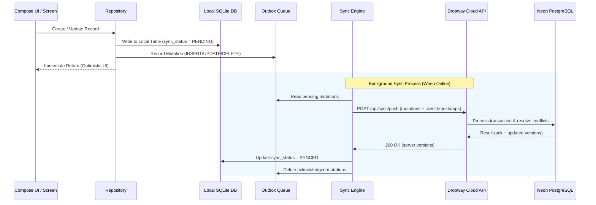

# Dropway Mobile & Backend — Architecture Specification

## 1. Architectural Overview

Dropway utilizes a **Cloud-First + Offline-Capable Clean Architecture**. The architecture ensures that while the central cloud service remains the authoritative source of truth, all critical operational paths (viewing addresses, adding/editing homes, running delivery routes, searching records) execute with zero latency against local SQLite storage.

```
+---------------------------------------------------------------------------------------+
|                                    PRESENTATION LAYER                                 |
|  Compose UI (Screens: Navigation, Houses, Folders, Scan, Settings) + Theme + Badges  |
|  ViewModels / State Holders (NavigationViewModel, HousesViewModel, AuthViewModel)     |
+---------------------------------------------------------------------------------------+
                                           |
                                           v
+---------------------------------------------------------------------------------------+
|                                      DOMAIN LAYER                                     |
|  Entities: House, Folder, NavigationStop, UserProfile, Subscription, SyncMutation      |
|  Use Cases: SyncOutboxUseCase, MatchAddressUseCase, ScanLabelUseCase, ShareFolder...  |
|  Repository Interfaces: HouseRepository, FolderRepository, AuthRepository, SyncRepo  |
+---------------------------------------------------------------------------------------+
                                           |
                                           v
+---------------------------------------------------------------------------------------+
|                                       DATA LAYER                                      |
|  Repository Implementations: HouseRepositoryImpl, FolderRepositoryImpl, AuthRepoImpl  |
|  Local Storage: SQLite Database (v2 Schema) + Android KeyStore (AES-256-GCM)          |
|  Remote API: DropwayApiClient (HttpURLConnection/JSON) + Cloud Auth Interceptor       |
|  Sync Engine: Outbox Mutation Queue + Retry Backoff + Conflict Resolver               |
+---------------------------------------------------------------------------------------+
                                           |
                              HTTP / TLS 1.3 (JSON)
                                           v
+---------------------------------------------------------------------------------------+
|                                 CLOUD BACKEND (NEON PG)                               |
|  Next.js / Node.js API Routes (REST)                                                  |
|  PostgreSQL Database (Neon Serverless DB)                                             |
|  Google Gemini 2.0 Vision API (Label OCR & Entity Extraction)                         |
+---------------------------------------------------------------------------------------+
```

---

## 2. Layer Responsibilities

### Presentation Layer (`com.pocketdev.dropway.ui`)
- **Jetpack Compose & Material 3:** Declarative UI screens strictly adhering to the **Zero Emoji** policy (using vector iconography only).
- **Edge-to-Edge:** Proper handling of window insets preventing UI overlaps under status and navigation bars.
- **ViewModels:** Maintain screen UI state via Kotlin `StateFlow`, handle user actions, and invoke Domain Use Cases / Repositories.

### Domain Layer (`com.pocketdev.dropway.domain`)
- **Entities:** Pure Kotlin data classes decoupled from database rows or network JSON structures (`House`, `Folder`, `NavigationHouse`, `User`, `SyncMutation`).
- **Repository Contracts:** Clean interfaces defining data operations (`HouseRepository`, `FolderRepository`, `SyncRepository`, `AuthRepository`).
- **Use Cases / Interactors:** Encapsulate business logic such as multi-stop route sequencing, duplicate detection, and address matching.

### Data Layer (`com.pocketdev.dropway.data`)
- **Local Source of Truth (`data/local`):** `LocalHouseDatabase` (SQLiteOpenHelper) managing tables: `houses`, `folders`, `folder_houses`, `user_navigation_houses`, `outbox_mutations`, and `user_profile`.
- **Remote Source of Truth (`data/remote`):** `DropwayApiClient` communicating with Dropway REST API over TLS 1.3 with JWT authentication headers.
- **Sync & Outbox Engine (`data/sync`):** Captures all local write operations (`INSERT`, `UPDATE`, `DELETE`) as durable outbox mutations that are sent to the cloud upon network availability.
- **Cryptographic Vault (`data/sharing`):** Keystore-backed AES-256-GCM encryption and HMAC-SHA256 signatures for folder sharing and QR exchange.

---

## 3. Data Synchronization Flow



---

## 4. Key Architectural Guarantees
1. **Zero UI Blocking:** All database and network I/O are dispatched on `Dispatchers.IO` or dedicated background workers.
2. **Crash Resilience:** Database transactions (`db.beginTransaction()`) protect all multi-table mutations.
3. **Idempotency:** Every mutation generated in the outbox carries a UUIDv4 `idempotency_key`, preventing double-writes on network retries.
4. **Graceful Degradation:** When offline, AI OCR falls back to local regex heuristics, remote map tiles fall back to local cached tiles, and sync mutations queue safely.
