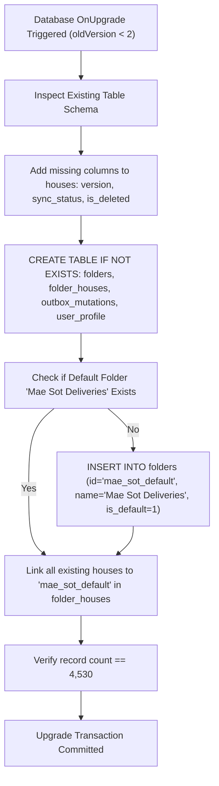

# Dropway Data Migration Strategy (Mae Sot Dataset & Version Upgrades)

## 1. Ingesting & Preserving the Mae Sot Dataset

The active Dropway deployment includes **4,530 historical delivery records** within the Mae Sot district (Tak Province, Thailand). These records represent months of field collection by local couriers and drivers. **Zero data loss or coordinate corruption is tolerated.**

### Dataset Profile & Characteristics
- **Total Records:** 4,530 addresses.
- **Geographic Bounding Box:**
  - Latitude: $16.6500^\circ\text{N} \le \text{lat} \le 16.7800^\circ\text{N}$
  - Longitude: $98.5000^\circ\text{E} \le \text{lng} \le 98.6500^\circ\text{E}$
- **Key Fields:**
  - `house_no`: String (e.g., `123/4`, `55`, `99/12 หมู่ 3`)
  - `village`: Moo identifier (e.g., `หมู่ 1`, `หมู่ 10`)
  - `subdistrict`: Subdistrict (e.g., `แม่ปะ`, `แม่สอด`, `ท่าสายลวด`, `แม่ตาว`)
  - `district`: `แม่สอด` (Mae Sot)
  - `province`: `ตาก` (Tak)
  - `postal_code`: `63110`
  - `latitude`, `longitude`: Double precision coordinates.
  - `phone`, `recipient_name`, `notes`, `landmark`.

---

## 2. SQLite Migration Protocol (v1 -> v2)

The mobile application utilizes `LocalHouseDatabase.kt`. When upgrading to Database Version 2:



### SQL Upgrade Script Execution
```sql
-- Step 1: Ensure columns exist in houses
ALTER TABLE houses ADD COLUMN version INTEGER DEFAULT 1;
ALTER TABLE houses ADD COLUMN sync_status TEXT DEFAULT 'SYNCED';
ALTER TABLE houses ADD COLUMN is_deleted INTEGER DEFAULT 0;

-- Step 2: Create new relational tables
CREATE TABLE IF NOT EXISTS folders (
    id TEXT PRIMARY KEY,
    name TEXT NOT NULL,
    description TEXT DEFAULT '',
    color TEXT DEFAULT '#3B82F6',
    icon TEXT DEFAULT 'folder',
    is_default INTEGER DEFAULT 0,
    is_archived INTEGER DEFAULT 0,
    sort_order INTEGER DEFAULT 0,
    sync_status TEXT DEFAULT 'SYNCED',
    created_at INTEGER DEFAULT (strftime('%s', 'now') * 1000),
    updated_at INTEGER DEFAULT (strftime('%s', 'now') * 1000)
);

CREATE TABLE IF NOT EXISTS folder_houses (
    folder_id TEXT NOT NULL,
    house_id TEXT NOT NULL,
    added_at INTEGER DEFAULT (strftime('%s', 'now') * 1000),
    sync_status TEXT DEFAULT 'SYNCED',
    PRIMARY KEY (folder_id, house_id)
);

CREATE TABLE IF NOT EXISTS outbox_mutations (
    id TEXT PRIMARY KEY,
    entity_type TEXT NOT NULL,
    entity_id TEXT NOT NULL,
    action TEXT NOT NULL,
    payload TEXT NOT NULL,
    client_timestamp INTEGER NOT NULL,
    retry_count INTEGER DEFAULT 0,
    last_error TEXT DEFAULT '',
    status TEXT DEFAULT 'PENDING'
);

CREATE TABLE IF NOT EXISTS user_profile (
    id TEXT PRIMARY KEY,
    email TEXT NOT NULL,
    display_name TEXT NOT NULL,
    auth_token TEXT NOT NULL,
    plan_type TEXT DEFAULT 'free',
    last_synced_at INTEGER DEFAULT 0
);

-- Step 3: Populate default Mae Sot Folder and Associations
INSERT OR IGNORE INTO folders (id, name, description, color, icon, is_default, sort_order)
VALUES ('mae_sot_default', 'Mae Sot Deliveries', 'Default repository for Mae Sot zone addresses', '#3B82F6', 'folder', 1, 0);

INSERT OR IGNORE INTO folder_houses (folder_id, house_id)
SELECT 'mae_sot_default', id FROM houses;
```

---

## 3. Data Cleansing & Validation Rules
1. **Phone Number Sanitization:** Strip spaces, hyphens, and ensure prefix is Thai standard (`08x`, `09x`, `06x` or `+66`).
2. **Coordinate Validation:** Check that $15.0 \le \text{lat} \le 21.0$ and $97.0 \le \text{lng} \le 106.0$. If coordinates fall outside Mae Sot, flag with `needs_review` tag while preserving raw values.
3. **Deduplication:** Matching rule: identical `house_no` + `subdistrict` + coordinate distance $< 15$ meters flags potential duplicate for user confirmation.
