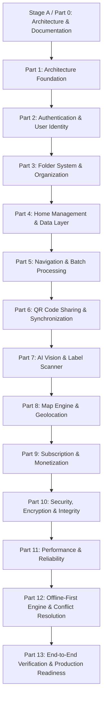

# Dropway Mobile & Backend Rebuild — Master Plan

## 1. System Mission & Objectives
Dropway is a high-performance delivery navigation and address management platform tailored for couriers, fleet drivers, and logistics dispatchers. The platform operates primarily in environments where cellular connectivity may be intermittent or absent, necessitating a **Cloud-First + Offline-Capable Architecture**.

### Core Tenets
1. **Cloud-First Truth, Local-First Experience:** The central cloud PostgreSQL database serves as the ultimate source of truth, while the local Android SQLite database acts as a full-featured, zero-latency operational replica supporting complete offline read/write capabilities with an outbox sync engine.
2. **Modular Clean Architecture:** Separation of concerns into Domain (Entities, Use Cases, Repositories), Data (Local SQLite, Remote HTTP, Outbox Sync), and UI (Jetpack Compose, Material3, ViewModels).
3. **Rock-Solid Security & Zero Emoji:** Strict ownership enforcement, HMAC/Keystore cryptographic signing for data sharing, robust data validation, and clean, professional vector iconography without any unicode emoji.
4. **Resilient Data Migration:** Flawless ingestion and preservation of existing operational datasets (such as the 4,530 Mae Sot records) without data corruption or loss.

---

## 2. The 14-Part Rebuild Roadmap

### Detailed Breakdown of Parts

| Part | Title | Scope & Deliverables | Primary Artifacts |
|---|---|---|---|
| **Part 0** | Architecture Audit & Master Docs | Comprehensive technical specs, schemas, sync protocol, and API contracts. | `docs/rebuild/*.md` |
| **Part 1** | New Architecture Foundation | Domain model layer, repository contracts, Result envelopes, API client interface, local SQLite migration v2. | `domain/model/*`, `domain/repository/*`, `data/local/db/*`, `data/remote/api/*` |
| **Part 2** | Authentication & User Identity | Session tokens, secure credential storage via Android KeyStore, user profile management, remote auth integration. | `domain/usecase/auth/*`, `data/repository/AuthRepositoryImpl.kt`, `ui/screens/AuthScreen.kt` |
| **Part 3** | Folder System & Organization | Folder hierarchies, color/icon tagging, sorting, default Mae Sot folder mapping, folder switcher UI. | `domain/model/Folder.kt`, `domain/repository/FolderRepository.kt`, `ui/screens/FoldersScreen.kt` |
| **Part 4** | Home Management & Data Layer | Unified CRUD for houses, coordinate parsing, phone validation, outbox change recording, detail view. | `domain/model/House.kt`, `data/repository/HouseRepositoryImpl.kt`, `ui/screens/HousesScreen.kt` |
| **Part 5** | Navigation & Batch Processing | Multi-stop delivery sequencing, status transitions (Pending, En Route, Delivered, Failed), parcel metadata. | `domain/model/NavigationHouse.kt`, `ui/screens/NavigationScreen.kt` |
| **Part 6** | QR Code Sharing & Synchronization | Cryptographic QR payload generator, camera/gallery scanning, folder share tokens, permission enforcement. | `data/sharing/QRShareManager.kt`, `ui/components/QRShareDialog.kt` |
| **Part 7** | AI Vision & Label Scanner | Gemini 2.0 Flash / Pro integration, boundary detection, field extraction (recipient, phone, address, tracking). | `util/LabelParser.kt`, `data/remote/GeminiVisionClient.kt`, `ui/screens/ScanScreen.kt` |
| **Part 8** | Map Engine & Geolocation | 16 map tile providers with Google Satellite default, Leaflet bridge, offline tile cache, compass bearing. | `util/MapProviderRegistry.kt`, `ui/components/MapPickerDialog.kt` |
| **Part 9** | Subscription & Monetization | Central pricing config (`SubscriptionConfig.kt`), tier entitlements (Free, Pro, Fleet), anti-tamper check. | `data/sharing/SubscriptionConfig.kt`, `ui/screens/SubscriptionScreen.kt` |
| **Part 10** | Security, Encryption & Integrity | Android KeyStore AES-256-GCM encryption, HMAC verification, API token rotation, input sanitization. | `data/sharing/VaultCryptoManager.kt`, `data/security/*` |
| **Part 11** | Performance & Reliability | SQLite indices, compiled regex matching (`SearchMatcher.kt`), background thread dispatching, debounce. | `util/SearchMatcher.kt`, `data/local/LocalHouseDatabase.kt` |
| **Part 12** | Offline-First Engine & Conflict Resolution | Outbox mutation queue, retry backoff with jitter, vector clock / server-authority conflict resolution. | `data/sync/SyncManager.kt`, `data/sync/OutboxWorker.kt` |
| **Part 13** | End-to-End Verification & Production Readiness | Full build verification, regression suite, migration testing with 4,530 Mae Sot records, release readiness. | Verification reports, release build |

---

## 3. Milestones & Delivery Schedule
1. **Milestone 1 (Foundation):** Part 0 and Part 1 complete. Architecture defined, models established, database migrated to v2, build passes.
2. **Milestone 2 (Core Data & User Layer):** Parts 2, 3, 4, 5 complete. Auth, folders, homes CRUD, navigation flow working with offline outbox.
3. **Milestone 3 (Advanced Capabilities):** Parts 6, 7, 8 complete. QR sharing, AI scanner, map engine integrated.
4. **Milestone 4 (Hardening & Polish):** Parts 9, 10, 11, 12 complete. Subscriptions, security vault, performance indexing, sync engine.
5. **Milestone 5 (Release Verification):** Part 13 complete. E2E tests, dataset migration dry-runs, release APK built and verified.
