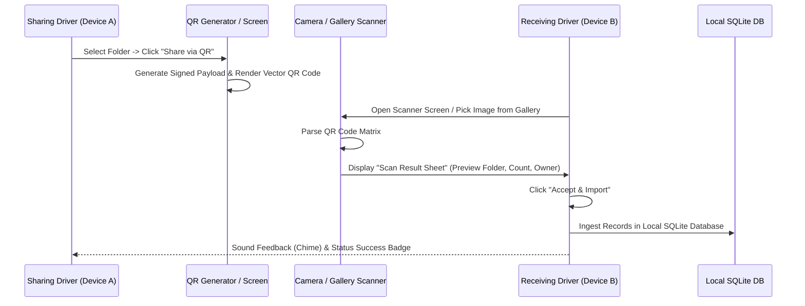

# Dropway QR Code Sharing & Synchronization Specification

## 1. Purpose & Use Cases
Dropway drivers often work in teams or handover delivery territories to substitute drivers. QR code sharing enables instant, secure transfer of:
1. **Individual Delivery Routes:** Today's batch of 40 parcels with optimized order.
2. **Entire Address Folders:** Zone address books containing hundreds or thousands of pinned houses.
3. **Individual House Cards:** Instant landmark and coordinate sharing between drivers.

---

## 2. QR Code Payload Structure

To ensure fast scanning even with budget phone cameras in low light or glare, the QR payload is formatted as a compact, Base64URL-encoded, signed JSON payload:

```json
{
  "v": 2,
  "t": "FOLDER_SHARE",
  "id": "folder-mae-sot-001",
  "name": "Mae Sot Zone 2",
  "count": 45,
  "perm": "RO",
  "exp": 1732339200,
  "sig": "a3f89b...signature"
}
```

### Field Definitions
- `v`: Protocol version (`2`).
- `t`: Payload type:
  - `FS`: Folder Share
  - `RS`: Route/Navigation Share
  - `HS`: Single House Share
- `id`: Cloud or Local UUID.
- `name`: Display name for preview confirmation sheet.
- `count`: Number of items enclosed.
- `perm`: Permissions granted (`RO` = Read-Only, `RW` = Read-Write).
- `exp`: Unix timestamp expiration (e.g., 24 hours from creation).
- `sig`: HMAC-SHA256 signature generated using driver vault key.

---

## 3. Workflow & UX Design



---

## 4. Import & Duplicate Resolution

When importing houses from a shared QR code:
1. **Existing Check:** Match by `id` or combination of `(house_no, subdistrict, coords within 10m)`.
2. **Preserve Custom Notes:** If a driver already has private notes on a house, prompt:
   - "Keep Existing Notes"
   - "Overwrite with Shared Notes"
   - "Merge Both Notes"
3. **Folder Assignment:** Place all newly imported houses directly into an imported folder named `<Original Name> (Shared by <Driver>)`.
