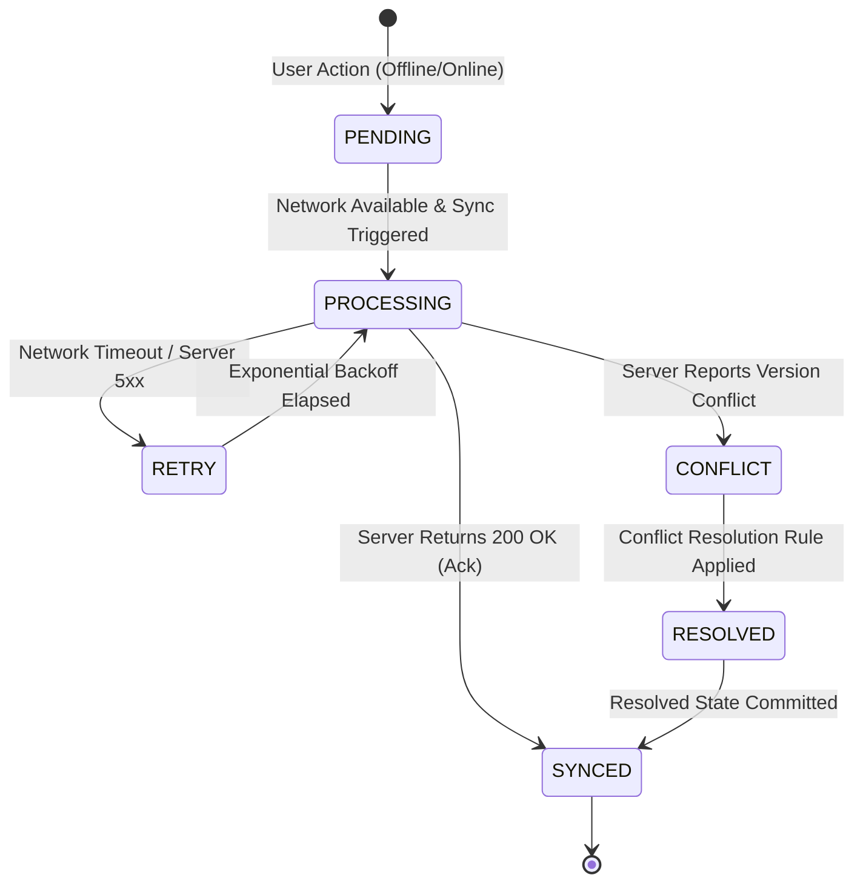

# Dropway Sync & Offline-First Engine Specification

## 1. Offline-First Philosophy
Courier delivery routes often take drivers into remote mountain passes, deep warehouse complexes, and rural villages where 4G/5G signals drop out completely. Dropway is engineered so that **100% of user workflows operate seamlessly offline**:
- Searching 4,500+ records executes in $< 10$ milliseconds against local indexed SQLite.
- Adding, editing, or deleting homes queues durable outbox records.
- Updating delivery progress (Mark Delivered, En Route, Call Customer) functions without network connection.
- When connectivity resumes, the background sync engine transmits changes and fetches cloud updates.

---

## 2. The Outbox Mutation Queue

Whenever a write operation occurs on the client, it is executed atomically within a SQLite transaction:
1. **Local State Update:** The target table (`houses`, `folders`, `user_navigation_houses`) is modified immediately with `sync_status = 'PENDING_INSERT'` (or `PENDING_UPDATE` / `PENDING_DELETE`).
2. **Outbox Entry Recorded:** A record is inserted into `outbox_mutations`:
   - `id`: Unique Idempotency Key (UUIDv4)
   - `entity_type`: `'HOUSE' | 'FOLDER' | 'NAVIGATION'`
   - `entity_id`: ID of the target record
   - `action`: `'CREATE' | 'UPDATE' | 'DELETE'`
   - `payload`: Serialized JSON payload containing changed attributes
   - `client_timestamp`: Milliseconds since epoch
   - `status`: `'PENDING'`

---

## 3. Sync State Machine

### Conflict Resolution Strategy: Server Authority + Field-Level Merge
- **Version Tracking:** Every record has an incrementing `version` integer.
- **Rule 1 (Delivery Status Priority):** If a local status update (`delivered_at`) conflicts with a remote update, the **latest timestamp** wins to ensure delivery proof is never erased.
- **Rule 2 (Coordinate Accuracy):** If coordinates are updated locally by a driver physically standing at the location, local coordinates take precedence over remote batch updates.
- **Rule 3 (Server Authority for Hierarchy):** Folder renames and deletions follow server authority when conflicts cannot be automatically resolved.

---

## 4. Exponential Backoff & Retry Logic

When network requests fail due to connectivity dropouts or 5xx server errors:
$$\text{Delay}(n) = \min(\text{MaxDelay}, \text{InitialDelay} \times 2^{n}) \pm \text{Jitter}$$
- `InitialDelay`: 2 seconds
- `MaxDelay`: 60 seconds
- `Jitter`: Cryptographically random $\pm 20\%$ to avoid thunder-herd spikes against the cloud API.
- Max Retries: 5 attempts before marking mutation as `FAILED_WAITING_MANUAL`.
